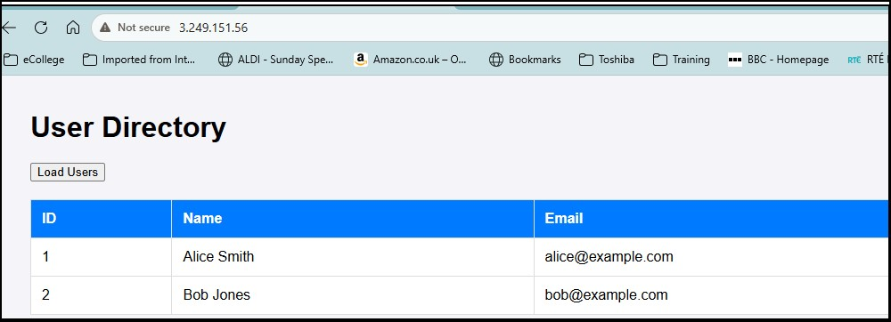

# 1-cloud-formation
ATU Cloud Formation Assignment for Lab1
## Introduction. 
This assignment demonstrate using a S3 bucket as a data store for static webpages and concepts of three tier architectures.
## Branch Naming Styles
I used a branch naming style of **```<type>/<description>```** to aid clarity, and pull requests start with the name of the branch.
Examples : feature/add-index.html or doc/add-docs.

##  Part 1  - Create a static website using AWS S3
Part 1 demonstrates the creation of a cloudformation script to create a static website. 
See [CLI Commands ](infra/cli/cli_commands.md) for the steps used. 

1. Create and validate Static Website. 
* Create S3 bucket, apply changes to enable static website hosting.
* Edit public address settings (to allow public access)
* Apply a bucket policy to make content publicy available. 
* Add index.html and error.html files.

2. Use AWS IaC generator.
* Scan Resources and Create Template file.
* Import to a CloudFormation Stack.
* Save template file to GitHub repository (CFtemplate-Assignment1-template.yaml). 

3.Apply the [Cloud Formation Template](/infra/CFtemplate-Assignment1-template.yaml) using AWS CLI stack command. 
````
aws cloudformation create-stack ^
  --stack-name CF-Stack-Assignment1 ^
  --template-body file://CFtemplate-Assignment1-template.yaml ^
  --region eu-west-1
````
* Redeploy the static files
aws s3 cp src/staticS3 s3://atu-l00213529-cloudformation/ --recursive --region eu-west-1

* Test the URL http://atu-l00213529-cloudformation.s3-website-eu-west-1.amazonaws.com/
* Delete the stack when validated. 


* See [workflows] (.github/workflows/Deploy-CF-part1.yml) I've used a GitHub Actions workflow to automate stack creation and file copy to S3. Cloud Formation does not have a mechanism to copy files directly and using GitHub actions would be a common practice.


## Part 2 - Create a 3 tier application (webserver, appnode + database)
To test CloudFormation I developed a a simple 3 tier application. 

|Layer | Server | Subnet |Description |
|---|---|---|---|
|Web|webserver|PublicWebSubnet|using node js and express. A web server on port 8080 will make a call to the App tier app via port 5000 using a local nodejs script|
|App|appserver|PrivateAppSubnet|using node js and express. Listening on port 5000, this will query MySQL Instance on port 3306 on the Dbtier. Simple function to retrieve records |
|DB|RDS MySQL Instance| This is Running on port 3306. Has a simple "company_db" database  with 2 records.|

A browser session to the IP address of the web tier will return a page with a load users button. Clicking this will result in a query to the database and records returned to the page. 


1. Create Networking Components. 
I manually the VPC and associated components on AWS console initially. IaC generator scanned the applicable resources and created the Template file. I used Co-Pilot to ID sections of the IaC generated script that were not required for the setup. 

* Note : I'm taking a modular approach in creating the stacks : network first, then compute stack.  This is in line with AWS best practices (see https://docs.aws.amazon.com/AWSCloudFormation/latest/UserGuide/best-practices.html#organizingstacks) . As the initial network components incur no cost , it is not neccessary to remove them after testing like EC2 or RDS databases. 

* Expaning on the original layout I found that RDS Database required 2 Subnets, each in an Availability Zone, irrespective of if I was replicating the database across them  see [AWS Docs](https://docs.aws.amazon.com/AmazonRDS/latest/UserGuide/USER_VPC.WorkingWithRDSInstanceinaVPC.html). I've updated the network to that in Pull request #16 
* Further update was required to allow me pass my IP address as a paremetrer to the Network script , so the Web Security Group could add that to the inbound rules for port 22. See Pull Request #17

* See [CF-NetworkStack-Assignment2.yaml](/infra/CF-NetworkStack-Assignment2.yaml). Apply using AWS CLI: 
````
aws cloudformation create-stack ^
--stack-name CF-NetworkStack-Assignment2 ^
--template-body file://CF-NetworkStack-Assignment2.yaml ^
--parameters ^
 ParameterKey=SSHLocation,ParameterValue=xx.xx.xx.xx/32 ^
 ParameterKey=VPCCidr,ParameterValue=xx.xx.xx.xx/16 ^
--region eu-west-1 ^
````


2. **Bas Web app.**
The code/files for the web application are in src\3tierapp. Consists of web front-end and mid-tier running nodejs and a backend MySQL database. 
- I tested this on a Promox VM host(homelab) with ubnutu 22.04 VM images and comprable security groups/port restrictions. It allowed me debug how to setup the nodejs application and pm2 and understand dependencies before running EC2 instances (nodejs was relatively new to me). 
  
3. **Create Cloud Formation Scripts for EC2 and RDS Database.** 
* Using the network cloud formation script I got the initial EC2/Database setup from Google AI [AI prompt](/notes/AI_prompts.txt).  
- I updated the UserData blocks to write the nodejs server files on the fly using my src\3tierapp , as they rely on parameter values available when the EC2 instance was being setup.
-  A more complex website would be better deployed by files in the git repo copied. They would be copied to a S3 bucket (similar to the approach in part 1 ) and then pulled into the EC2 instances.  Substituion scripts would need to replace placeholders with the actual parameter values. 

* See [EC2_CloudFormation.yml](/infra/EC2_CloudFormation.yml). Apply using AWS CLI : 

````
aws cloudformation create-stack ^
--stack-name CF-EC2Stack-Assignment2 ^
--template-body file://EC2_CloudFormation.yml ^
--region eu-west-1 ^
--parameters ^
ParameterKey=DBUsername,ParameterValue=xxx ^
ParameterKey=DBPassword,ParameterValue=xxxxxx ^
ParameterKey=DBName,ParameterValue=xxxxx ^
````
* Parameters common to both network and compute stacks AWS Systems Manager Parameter Store. (Values for web-tier HttpPort, mid tier App port and DB port )



* This part required a lot of troubeshooting:). Getting the package updates, correctly writing the nodejs files and running them correctly was a learning. 

4. **Script Improvements for portability, better access.**
* CF-NetworkStack-Assignment2.yaml :  User parameters define the VPCCidr, AppPort, HttpPort and Database Ports. These are applied to the relevant security groups. 
* EC2_CloudFormation.yml : User parameters define the  database connection values as well as values for AppPort, HttpPort and Database ports. 
* AWS Systems Manager Parameter Store : There are parameters common to both scripts, but I wanted flexibility to pass parameters inline as well. Parameter overrides won't allow you mix a json input file with inline commands. I decided to use the Parameter Store for the *AppPort*, *HttpPort* and *Database* port. 

* CF-ElasticIP.yaml: ElasticIP : I created an elastic IP and associated it with the webserver. This script was generated by Co-Pilot prompt by providing the existing scripts (see [here](/notes/AI_prompts.txt). I want to keep this modular, and be able to validate the stages as I move on as well as being able to create/update in stages. 

* See [CF-ElasticIP.yaml](/infra/CF-ElasticIP.yaml). Apply using AWS CLI : 

````
aws cloudformation create-stack ^
--stack-name CF-ElasticIPStack-Assignment2 ^
--template-body file://CF-ElasticIP.yaml ^
--region eu-west-1 
````

5. **High Availability Changes**
* To explore a High Availability I decided to keep using EC2 instances as I more familiar with this for troubleshooting and internal application setup,  and just replicate the required resources to a 2nd Availability Zone.  (Google AI suggested Auto Scaling Groups originally)
* The Google AI prompt [here](/notes/AI_prompts.txt) provided me with changes to the 3 scripts I worked with so far. 


When applying the stacks they are done in this order as there are dependences between them : 

1.  [CF-NetworkStack-Assignment2-HA.yaml](/infra/CF-NetworkStack-Assignment2-HA.yaml) : This adds subnets to a 2nd AZ, and removes access to the private app subnet (compromise from earlier so I could update/install  on appserver. )

2.  [CF-EC2Stack-Assignment-HA.yaml](/infra/EC2_CloudFormation-HA.yaml): Adds two servers per WebServer and AppServer tier, and an internal load balancer between then.  The RDS SQL database was changed to a Multi Availability Zone configuation). Finally a public load balancer was added. 

3. [CF-ElasticIP-HA.yaml](/infra/CF-ElasticIP-HA.yaml): This binds the elastic IP to the public load balancer
(teardown in reverse order)

This scripts were run , some troubleshooting required as AI changed the nodejs installation and broke the deployment. I reverted this to the version I knew worked. 
Also the websecurity group needed a specific ingress rule (port 5000) for the appserver nodejs server.  


## ToDo/Issues
 - ~~Incorrect sequencing the creation of the nodejs components caused the startup to fail.~~ This has been corrected. 
 - ~~Database setup is not automated. I need to ssh to the app node, login to mysql and run [init.sql](src/3tierapp/database/init.sql) ~~ This has been corrected. 
 - ~~The external IP of the webserver is subject to change. For a production system and elastic IP and associated gateway is needed. ~~  Elastic IP solves that. 
 - ~~The environment is not a high availability configuration.~~ HA is now configured. 
 - The website is not secured with a SSL cert. 
 - Database username/password are passed as inline parameters. It's possible to change to AWS Parameter store as secure string, but need further work to set up IAM roles that can read the parameters from within the UserData setup. Alternatively if I use GitHub actions, these can be secret values. 
 - ~~ Network configuration has hardcoded values for VPC, subnets.~~ This has been replaced with a VPCCidr parameter and I derive the subnet CIDR ranges from that .


## Co-Pilot/Google AI  prompts
See [AI_prompts.txt](/notes/AI_prompts.txt)

## Contact
Feel free to contact mailto:L00213529@atu.ie with questions or suggestions.