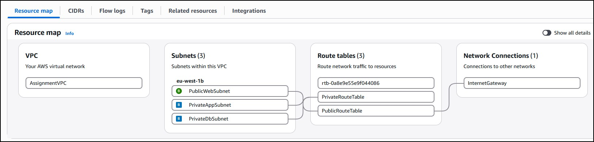

# 1-cloud-formation
ATU Cloud Formation Assignment for Lab1
## Introduction. 
This assignment will demonstrate the concepts of three tier architectures and using S3 as a data store for static web pages.
## Branch Naming Styles
I will be using a branch naming style of **```<type>/<description>```** to aid clarity. 
Examples will be feature/001-add-index.html or doc/002-add-docs where a sequential number simulates a ticket number from a tracking system. 

##  Part 1  - Create a static website using AWS S3
Part 1 demonstrates the creation of a cloudformation script to create a static website. 
See [CLI Commands ](infra/cli/cli_commands.md) for the steps used. 

1. Create and validate Static Website. 
* Create S3 bucket, apply changes to enable static website hosting.
* Edit public address settings (to allow public access)
* Apply a bucket policy to make content publicy available. 
* Add index.html and error.html files.

2. Use AWS IaC generator.
* Scan Resources and Create Template file.
* Import to a CloudFormation Stack.
* Save template file to GitHub repository (CFtemplate-Assignment1-template.yaml). 

3.Apply the Cloud Formation Template.
````
aws cloudformation create-stack ^
  --stack-name CF-Stack-Assignment1 ^
  --template-body file://CFtemplate-Assignment1-template.yaml ^
  --region eu-west-1
````
* Redeploy the static files
aws s3 cp src/ s3://atu-l00213529-cloudformation/ --recursive --region eu-west-1

* Test the URL http://atu-l00213529-cloudformation.s3-website-eu-west-1.amazonaws.com/


## Part 2 - Create a 3 tier application (webserver, appnode + database)
To test CloudFormation I developed a a simple 3 tier application

|Layer | Server | Subnet |Description |
|---|---|---|---|
|Web|webserver|PublicWebSubnet|using node js and express. A web server on port 8080 will make a call to the App tier app via port 5000 using a local nodejs script|
|App|appserver|PrivateAppSubnet|using node js and express. Listening on port 5000, this will query MySQL Instance on port 3306 on the Dbtier. Simple function to retrieve records |
|DB|RDS MySQL Instance| This is Running on port 3306. Has a simple "company_db" database  with 2 records.|

A browser session to the IP address of the web tier will return a page with a load users button. Clicking this will result in a query to the database and records returned to the page. 

1. Create Networking Components. 
I created the VPC and associated components on AWS console initially. Then used IaC generator to scan applicable resources and created the Template file. Then edited the file to make a consistent naming scheme for the components. I used Co-Pilot to ID sections of the IaC generated script that were unnecessary and updated the file.

* Note : I wish to keep the VPC/subnets/security group creation seperate from the EC2 
instances and application setup. This is in line with AWS best practices (see https://docs.aws.amazon.com/AWSCloudFormation/latest/UserGuide/best-practices.html#organizingstacks) . As the network components here incurs no cost , it is not neccessary to remove them after testing like EC2 or RDS databases. 

* Expaning on the original layout I found that RDS Database required 2 Subnets, each in an Availability Zone, irrespective of if I was replicating the database across them  see [AWS Docs](https://docs.aws.amazon.com/AmazonRDS/latest/UserGuide/USER_VPC.WorkingWithRDSInstanceinaVPC.html). I've updated the network to that in Pull request #16 
* Further update was required to allow me pass my IP address as a paremetrer to the Network script , so the Web Security Group could add that to the inbound rules for port 22. See Pull Request #17

* The resulting Template file is [here](/infra/CF-NetworkStack-Assignment2.yaml). Apply this as follows : 
````
aws cloudformation create-stack ^
--stack-name CF-NetworkStack-Assignment2 ^
--template-body file://CF-NetworkStack-Assignment2.yaml ^
--parameters ^
 ParameterKey=SSHLocation,ParameterValue=xx.xx.xx.xx/32 ^
 ParameterKey=VPCCidr,ParameterValue=xx.xx.xx.xx/16 ^
--region eu-west-1 ^
--parameters file://CF_3tier_parameters.json
````
* Parameters common to both stacks are in [json file](/infra/CF_3tier_parameters.json)




Component|Name|Notes|
|---|---|---|
|VPC|AssignmentVPC |Paremeter “ VPCCidr “ is passed as the CIDR block value. Script contains basic validation. Default 10.10.0.0/16|
|Subnet|PublicWebSubnet|CIDR derived from VPCCirdr using a function e.g 10.10.0.0/24 |
|Subnet|PrivateAppSubnet|CIDR derived from VPCCirdr. e.g  10.10.1.0/24 |
|Subnet|PrivateDbSubnetA |CIDR is derived from VPCCirdr.e.g  10.10.2.0/24 |
|Subnet|PrivateDbSubnetB|CIDR is derived from VPCCirdr. e.g  10.10.3.0/24 . Create in different Availability Zone to DbSubnetA – a requirement of RDS SQL.|
|InternetGateway|InternetGateway |VPC is attached to this. |
|Route Table|PublicRouteTable|route table with route to Internet Gateway for internet. Associated with PublicWebSubnet|
|Route Table|PrivateRouteTable|route table with route to Internet Gateway for internet. Associated with PrivateAppSubnet and PrivateDbSubetA + B|
|Security Group|WebSecurityGroup|"Inbound rules for 22 (SSH from IP only)| 8080 (user parameter)|
|Security Group|AppSecurityGroup|"Inbound rule for 22 (SSH from web security group) | 5000 (user parameter).|
|Security Group|DbSecurityGroup|Inbound rule for 3306 ( from app security group)| 


2. **Create basic Web app.**
The code/files for the web application are in src\3tierapp. I got initial code from Google AI. 
- This has a webfront-end, node.js app running under the pm2 process manager. Web UI will call nodejs and query the mysql database on a database server.  
- I expanded this to a full 3 tier app , with a script on webserver forwarding calls to the appserver to query the SQL database. 
- For learning, I tested this on 3 homelab Ubuntu VMs with the same network isolation/security groups as the planned VPC.

3. **Create Cloud Formation Scripts for EC2 and RDS Database.** 
* The initial template structure was listed in an AWS article [here](https://repost.aws/articles/ARGpERJ3jISbOAlnmfVUsvMQ/building-a-secure-and-scalable-three-tier-architecture-on-aws-using-cloudformation).  In this case the app will be based on the code in src\3tierapp in this repo, but in this case the scripts for the nodejs components were created on the fly during standup of the EC2 instances. 

* The script is [here](/infra/EC2_CloudFormation.yml)

The script is applied as follows 

````
aws cloudformation create-stack ^
--stack-name CF-EC2Stack-Assignment2 ^
--template-body file://EC2_CloudFormation.yml ^
--region eu-west-1 ^
--parameters ^
ParameterKey=DBUsername,ParameterValue=xxx ^
ParameterKey=DBPassword,ParameterValue=xxxxxx ^
ParameterKey=DBName,ParameterValue=xxxxx ^
````
* Parameters common to both stacks AWS Systems Manager Parameter Store. 


4. **Script Improvements for portability, better availability.**
* CF-NetworkStack-Assignment2.yaml :  User parameters define the VPCCidr, AppPort, HttpPort and Database Ports. These are applied to the relevant security groups. 
* EC2_CloudFormation.yml : User parameters define the  database connection values as well as values for AppPort, HttpPort and Database ports. 
* AWS Systems Manager Parameter Store : I have  parameters common to both scripts, but wanted flexibility to pass parameters inline as well. Parameter overrides won't allow you mix a json input file with inline commands. I decided to use the Parameter Store for the AppPort, HttpPort and Database port. 

These can be referenced as in this example: 
````  DBPort:
    Type: AWS::SSM::Parameter::Value<String>
    Default: /shared/ports/DBPort
    Description: MySQL port
````
* ElasticIP : I created an elastic IP and associated it with the webserver. This script was generated by Co-Pilot prompt by providing the existing scripts (see [here](/notes/AI_prompts.txt). I want to keep this modular, and be able to validate the stages as I move on as well as being able to create/update in stages. 


## ToDo/Issues
 - I'm using the webserver for SSH access is not recommended.(should use a bastion server)  
 - ~~ Incorrect sequencing the creation of the nodejs components caused the startup to fail.~~ This has been corrected. 
 - ~~ Database setup is not automated. I need to ssh to the app node, login to mysql and run [init.sql](src/3tierapp/database/init.sql) ~~ This has been corrected
 - To enable updates to the mid-tier required an external IP address, and ensure that the "app-sg-assignment1" has an outbound rule allowing access. 
 - The external IP of the webserver is subject to change. For a production system and elastic IP and associated gateway is needed. 
 - The environment is not a high availability configuration.
 - The website is not secured with a SSL cert. 
 - Database username/password are passed as inline parameters. It's possible to change to AWS Parameter store as secure string, but need further work to set up IAM roles that can read the parameters from within the UserData setup. 
 - ~~ Network configuration has hardcoded values for VPC, subnets.~~ This has been replaced with a VPCCidr parameter and I derive the subnet CIDR ranges from that . See [CF-NetworkStack-Assignment2.yaml](infra/CF-NetworkStack-Assignment2.yaml)


## Co-Pilot/Google AI  prompts
Generate a basic cloud formation script that creates a basic flask based website and a rds database backend 

## Contact
Feel free to contact mailto:L00213529@atu.ie with questions or suggestions.